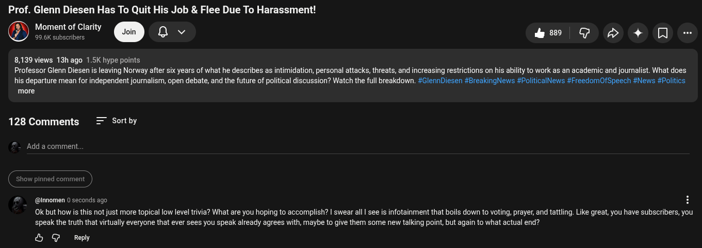

# Public Take transcript

## Machine transcription

Prof. Glenn Diesen Has To Quit His Job & Flee Due To Harassment!
Moment of Clarity
@ 99.6K subscribers @ Qv & S 4 [ -

8,139 views 13hago 1.5K hype points
Professor Glenn Diesen is leaving Norway after six years of what he describes as intimidation, personal attacks, threats, and increasing restrictions on his ability to work as an academic and journalist. What does

his departure mean for independent journalism, open debate, and the future of political discussion? Watch the full breakdown. #GlennDiesen #BreakingNews #PoliticalNews #FreedomOfSpeech #News #Politics

more

128 Comments = Sortby

Add a comment.

@ @Innomen 0 seconds ago
Ok but how is this not just more topical low level trivia? What are you hoping to accomplish? | swear all | see is infotainment that boils down to voting, prayer, and tattling. Like great, you have subscribers, you

speak the truth that virtually everyone that ever sees you speak already agrees with, maybe to give them some new talking point, but again to what actual end?

& G Reply
