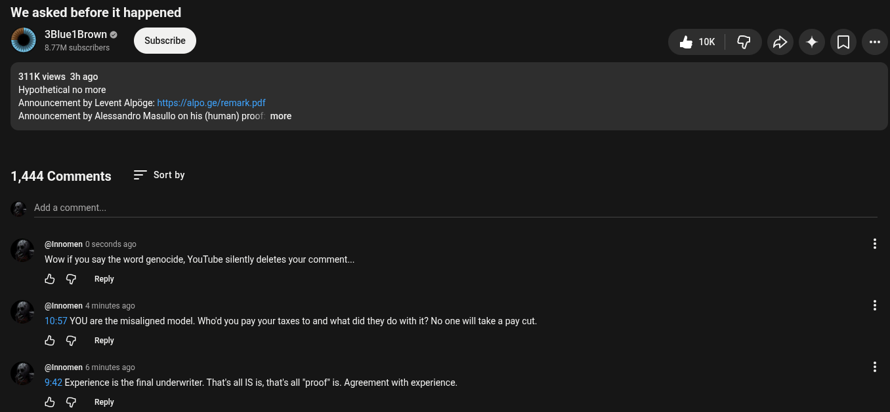

# Public Take transcript

## Machine transcription

We asked before it happened
3Blue’Brown © -
Subscri
8.77M subscribers

311K views 3hago
Hypothetical no more

Announcement by Levent Alpge: hips:/alpo.ge/remark pdf
Announcement by Alessandro Masullo on his (human) proof more

1,444 Comments = Sortby

Add a comment.

@ @Innomen 0 seconds ago
Wow if you say the word genocide, YouTube silently deletes your comment.

& G Reply

@ @innomen 4 minutes ago
10:57 YOU are the misaligned model. Who'd you pay your taxes to and what did they do with it? No one will take a pay cut.

& G Reply

@ @nnomen 6 minutes ago
9:42 Experience is the final underwriter. That's all IS is, that's all ‘proof” is. Agreement with experience.

& @ Reply

o 10k

T » + Q0
