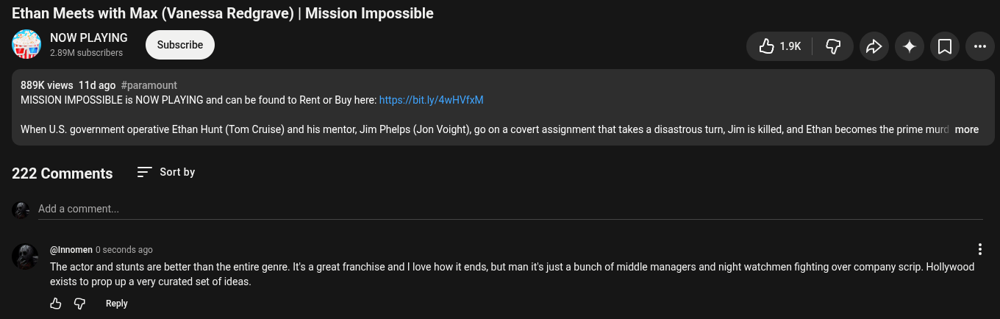

# Public Take transcript

## Machine transcription

Ethan Meets with Max (Vanessa Redgrave) | Mission Impossible

NOW PLAYING
. 289M subscribers Sub Nk G oS> ¢ Q-

889K views 11dago #paramount
MISSION IMPOSSIBLE is NOW PLAYING and can be found to Rent or Buy here: htps://bit ly/4wHVix\

When U.S. government operative Ethan Hunt (Tom Cruise) and his mentor, Jim Phelps (Jon Voight), go on a covert assignment that takes a disastrous tu, Jim is killed, and Ethan becomes the prime murc. more

222 Comments = Sortby

Add a comment

@ @Innomen 0 seconds ago H
The actor and stunts are better than the entire genre. Its a great franchise and | love how it ends, but man it just a bunch of middle managers and night watchmen fighting over company scrip. Hollywood
exists to prop up a very curated set of ideas.

& G Reply
