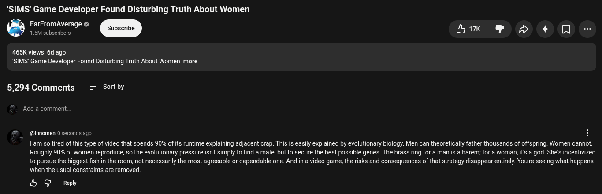

# Public Take transcript

## Machine transcription

'SIMS' Game Developer Found Disturbing Truth About Women
FarFromAverage ©
@ 1.5M subscribers ubserib Lk B D 4 [

465K views 6d ago
'SIMS’ Game Developer Found Disturbing Truth About Women more

5,294 Comments = Sortby
Add a comment

- (@Innomen 0 seconds ago H
1am so tired of this type of video that spends 90% of its runtime explaining adjacent crap. This is easily explained by evolutionary biology. Men can theoretically father thousands of offspring. Women cannot.
Roughly 90% of women reproduce, so the evolutionary pressure isnit simply to find a mate, but to secure the best possible genes. The brass ring for a man is a harem; for a woman, it a god. She's incentivized
to pursue the biggest fish in the room, not necessarily the most agreeable or dependable one. And in a video game, the risks and consequences of that strategy disappear entirely. You're seeing what happens
when the usual constraints are removed

& G Reply
