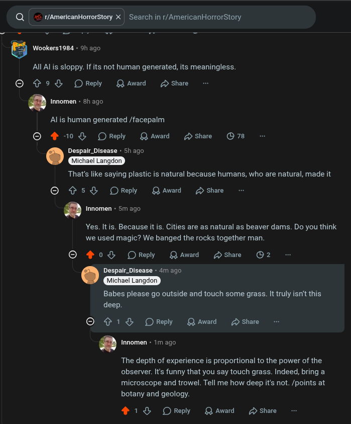

# Public Take transcript

## Machine transcription

Q| rAmericanHomorstory X | Search in i/ AmericanHorrorStory

g Wookers1984 - 9 ago
All Al sloppy. Ifits not human generated, its meaningless.

O ¢ 9% OReply QAwad 2 share

‘ Innomen - h ago

Alis human generated /facepalm

© 4 0L OReply QAward Dshare (G 78

. Despalr_Disease - 5h ago

That's like saying plastic is natural because humans, who are natural, made it

O ¢5& OReply QAwad 2 share

Q Innomen - 5m ago

Yes. Itis. Because itis. Cities are as natural as beaver dams. Do you think
we used magic? We banged the rocks together man.

© 0% ORreply QAward DHshae G2
Despalr_Disease - 4m 200
Michael Langdon

Babes please go outside and touch some grass. It truly isni't this
deep.

© ¢1& ORply Qawad DShare

’ Innomen - 1m ago

The depth of experience is proportional to the power of the
observer. It's funny that you say touch grass. Indeed, bring a
microscope and trowel. Tell me how deep it's not. /points at
botany and geology.

418 OReply QAward 2 Share
