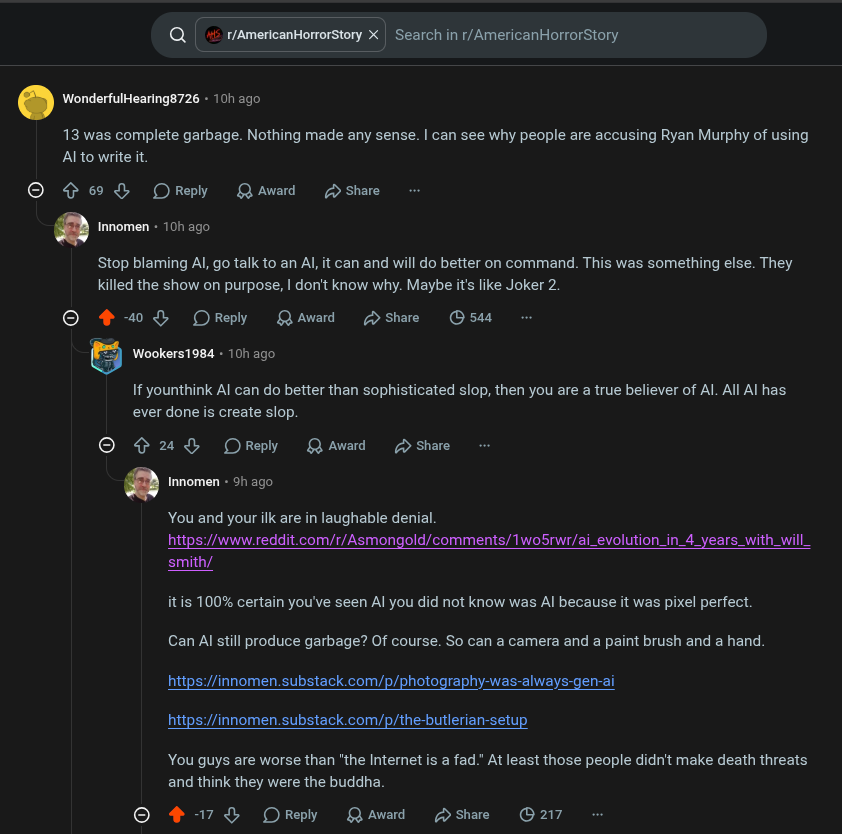

# Public Take transcript

## Machine transcription

Q | r/AmericanHorrorstory X | Search in r/AmericanHorrorStory

. WonderfulHearing8726 - 10h ago

13 was complete garbage. Nothing made any sense. | can see why people are accusing Ryan Murphy of using
Al to write it.

© ¢ 6 & ORpy QAward DHshare -

. Innomen - 10h ago

Stop blaming Al, go talk to an Al it can and will do better on command. This was something else. They
Killed the show on purpose, | don't know why. Maybe it like Joker 2.

O %40 OReply QAward Dshare (OG54

6 Wookers1984 - 10h ago

If younthink Al can do better than sophisticated slop, then you are a true believer of Al. All Al has
ever done s create slop.

© ¢ 248% OReply QAward D Share -

. Innomen - 9h ago

You and your ilk are in laughable denial.
https://www.reddit.com/r/Asmongold/comments/1woSrwr/ai_evolution_in_4_years_with_will_
smith/

itis 100% certain you've seen Al you did not know was Al because it was pixel perfect.
Can Al still produce garbage? Of course. So can a camera and a paint brush and a hand.

https://innomen.substack.com/p/photography-was-always-gen-ai

https://innomen.substack.com/p/the-butlerian-setup

You guys are worse than "the Internet is a fad."
and think they were the buddha

© 4 178% OReply QAward Dshare (©217

it least those people didn't make death threats
