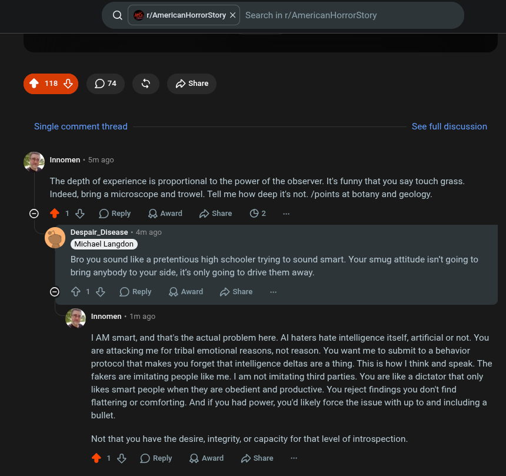

# Public Take transcript

## Machine transcription

Q| rAmericanHomorstory X | Search in i/ AmericanHorrorStory

Single comment thread See full discussion

. Innomen - 5m ago

The depth of experience is proportional to the power of the observer. Its funny that you say touch grass.
Indeed, bring a microscope and trowel. Tell me how deep it's not. /points at botany and geology.

O 1% OReply Qawad Dshare O2

Despalr_DI - 4m ago
Michael Langdon

Bro you sound like a pretentious high schooler trying to sound smart. Your smug attitude isn't going to
bring anybody to your side, it's only going to drive them away.

© ©1% OrReply QAaward D Share -

. Innomen - 1m ago.

1AM smart, and that's the actual problem here. Al haters hate intelligence itself, artificial or not. You
are attacking me for tribal emotional reasons, not reason. You want me to submit to a behavior
protocol that makes you forget that intelligence deltas are a thing. This is how | think and speak. The
fakers are imitating people like me. | am not imitating third parties. You are like a dictator that only
likes smart people when they are obedient and productive. You reject findings you don' find
fattering or comforting. And if you had power, you'd likely force the issue with up to and including a
bullet

Not that you have the desire, integrity, or capacity for that level of introspection.

218 OReply QAward 2 Share
