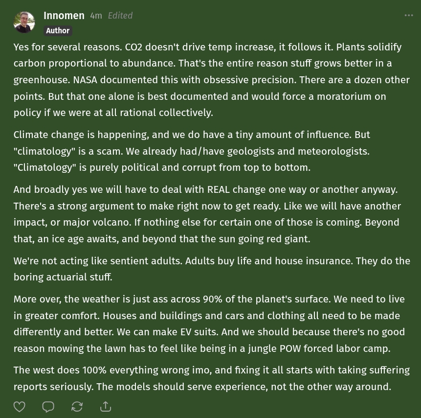

# Public Take transcript

## Machine transcription

‘Q Innomen 4m Edited
Author

Yes for several reasons. CO2 doesn't drive temp increase, it follows it. Plants solidify
carbon proportional to abundance. That's the entire reason stuff grows better in a
greenhouse. NASA documented this with obsessive precision. There are a dozen other
points. But that one alone is best documented and would force a moratorium on
policy if we were at all rational collectively.

Climate change is happening, and we do have a tiny amount of influence. But
"climatology" is a scam. We already had/have geologists and meteorologists.
"Climatology" is purely political and corrupt from top to bottom.

And broadly yes we will have to deal with REAL change one way or another anyway.
There's a strong argument to make right now to get ready. Like we will have another
impact, or major volcano. If nothing else for certain one of those is coming. Beyond
that, an ice age awaits, and beyond that the sun going red giant.

We're not acting like sentient adults. Adults buy life and house insurance. They do the
boring actuarial stuff.

More over, the weather is just ass across 90% of the planet's surface. We need to live
in greater comfort. Houses and buildings and cars and clothing all need to be made
differently and better. We can make EV suits. And we should because there's no good
reason mowing the lawn has to feel like being in a jungle POW forced labor camp.

The west does 100% everything wrong imo, and fixing it all starts with taking suffering
reports seriously. The models should serve experience, not the other way around.

(VR GIES AN
