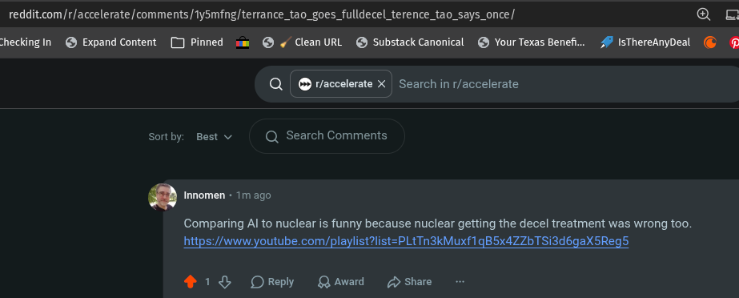

# Public Take transcript

## Machine transcription

reddit.com/r/accelerate /comments/Ty5mfng/terrance_tao_goes_fulldecel_terence_tao_says_once/ Oy =

hecking In @ Expand Content [7] Pinned +m @ ¢ CleanURL @ Substack Canonical @ Your Texas Benefi... 7 IsThereAnyDeal @ @

Q | @ raccelerate X | Search in r/accelerate

Sortby: Bestv | (Q Search Comments

‘ Innomen - 11 ago

Comparing Al to nuclear is funny because nuclear getting the decel treatment was wrong too.
hitps://www.youtube.com/playlist?Zlist=PLtTn3kMuxf1qB5x4ZZbTSi3d6gaX5Reg5

418 OReply QAward 2 share -
