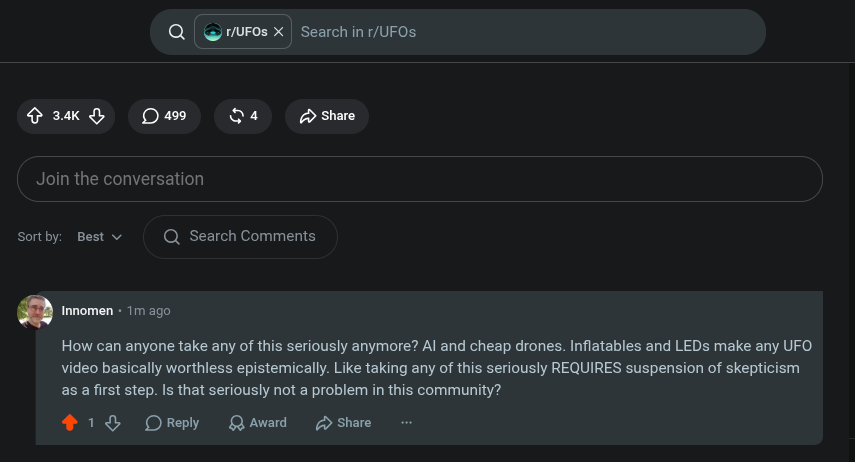

# Public Take transcript

## Machine transcription

Q | @r7UFos X | Search in r/UFOs

Sk Daw G4 Hshare

Join the conversation

Sortby: Bestv | Q SearchComments

. Innomen - 1 20

How can anyone take any of this seriously anymore? Al and cheap drones. Inflatables and LEDs make any UFO
video basically worthless epistemically. Like taking any of this seriously REQUIRES suspension of skepticism
as afirst step. Is that seriously not a problem in this community?

418 OReply QAward 2 share -
