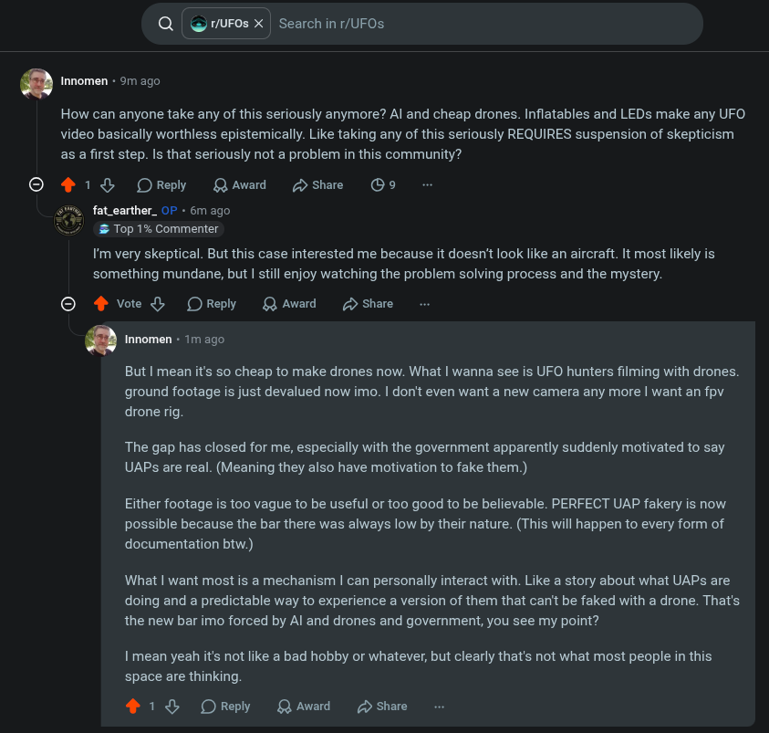

# Public Take transcript

## Machine transcription

Q | @r7UFos X | Search in r/UFOs

' Innomen - om ago

How can anyone take any of this seriously anymore? Al and cheap drones. Inflatables and LEDs make any UFO
video basically worthless epistemically. Like taking any of this seriously REQUIRES suspension of skepticism
as a first step. Is that seriously not a problem in this community?

© 18 OReply Qawad Hshare ©9

sy fat_earther_ OF - 6m ago

U 2 Top 1% Commenter
I'm very skeptical. But this case interested me because it doesn't look like an aircraft. It most likely is
something mundane, but | still enjoy watching the problem solving process and the mystery.

© #vote & OReply [ Award D Share

' Innomen - 1 20

But | mean it's so cheap to make drones now. What | wanna see is UFO hunters filming with drones.
ground footage s just devalued now imo. | donit even want a new camera any more | want an fpv
drone rig.

The gap has closed for me, especially with the government apparently suddenly motivated to say
UAPs are real. (Meaning they also have motivation to fake them.)

Either footage is too vague to be useful or too good to be believable. PERFECT UAP fakery is now
possible because the bar there was always low by their nature. (This will happen to every form of
documentation btw.)

What | want most is a mechanism | can personally interact with. Like a story about what UAPs are
doing and a predictable way o experience a version of them that can't be faked with a drone. That's
the new bar imo forced by Al and drones and government, you see my point?

I mean yeah it's not like a bad hobby or whatever, but clearly that's not what most people in this
space are thinking.

418 ORpy QAwad DHshare -
