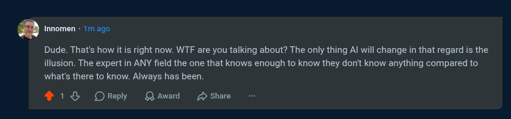

# Public Take transcript

## Machine transcription

@ Innomen - 11 20

Dude. That's how it i right now. WTF are you talking about? The only thing Al will change in that regard is the
illusion. The expert in ANY field the one that knows enough to know they donit know anything compared to
whats there to know. Always has been

418 OReply QAward 2 Share
